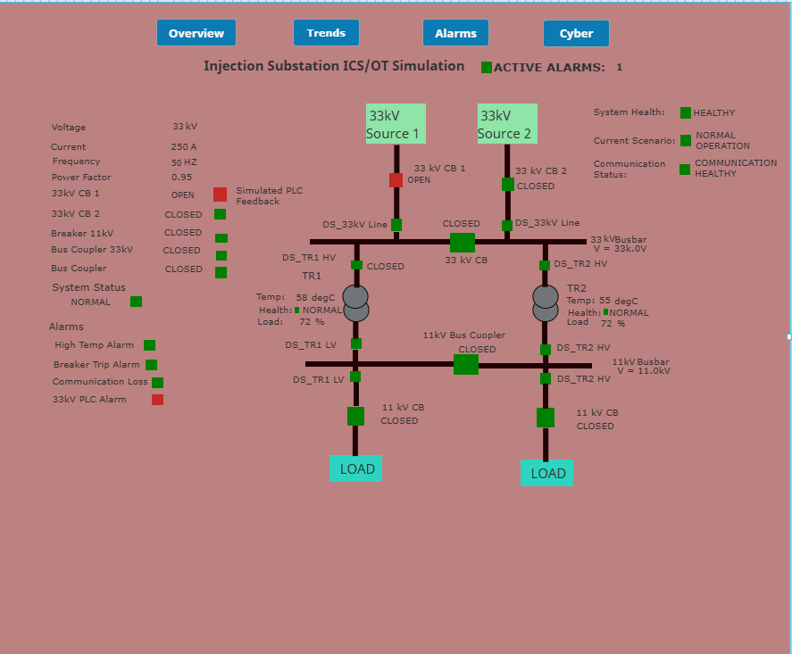
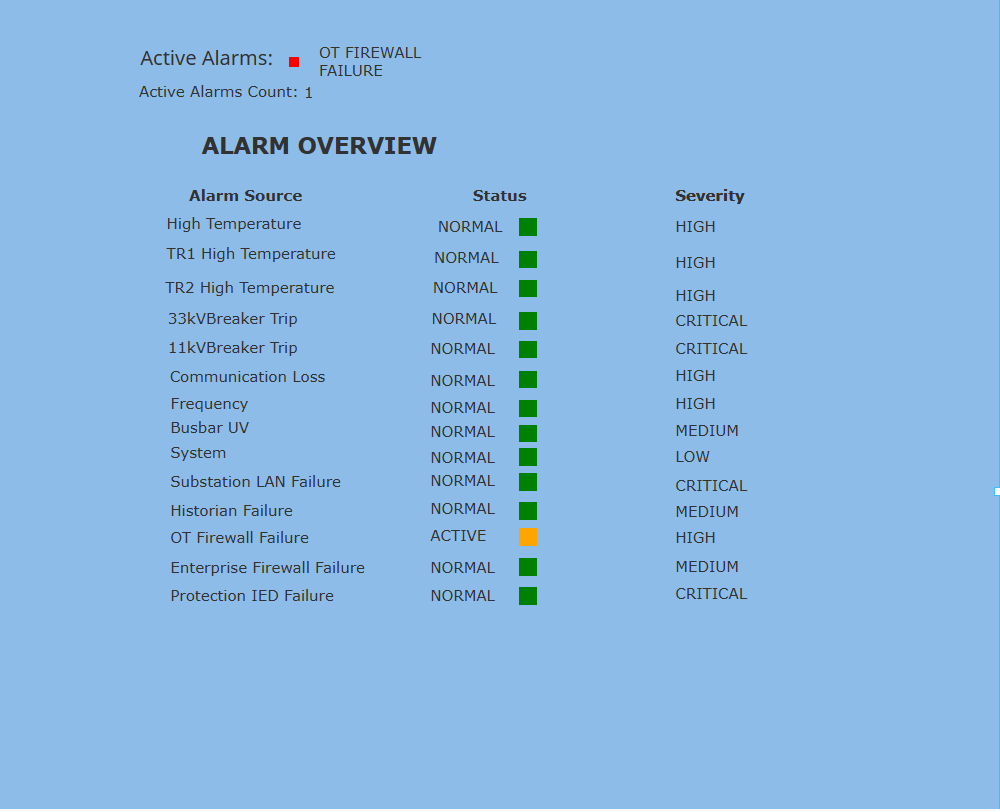
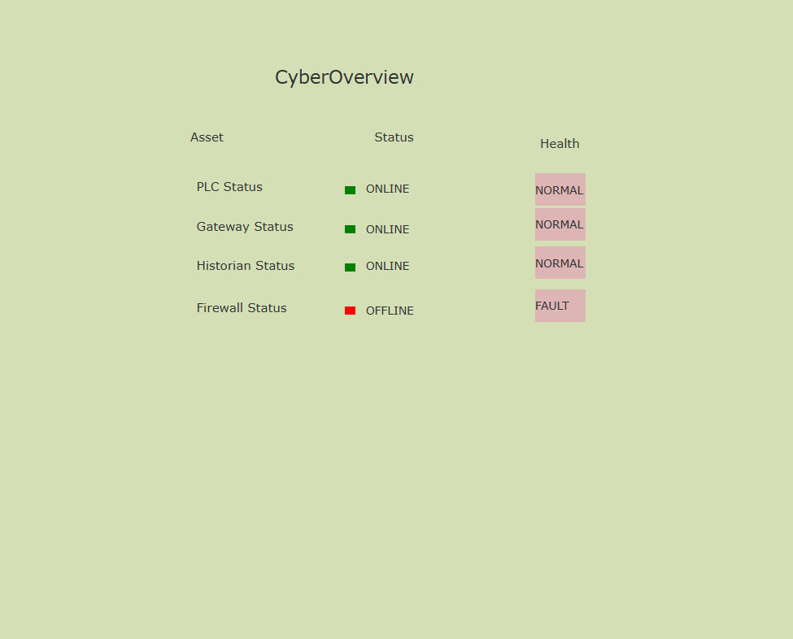
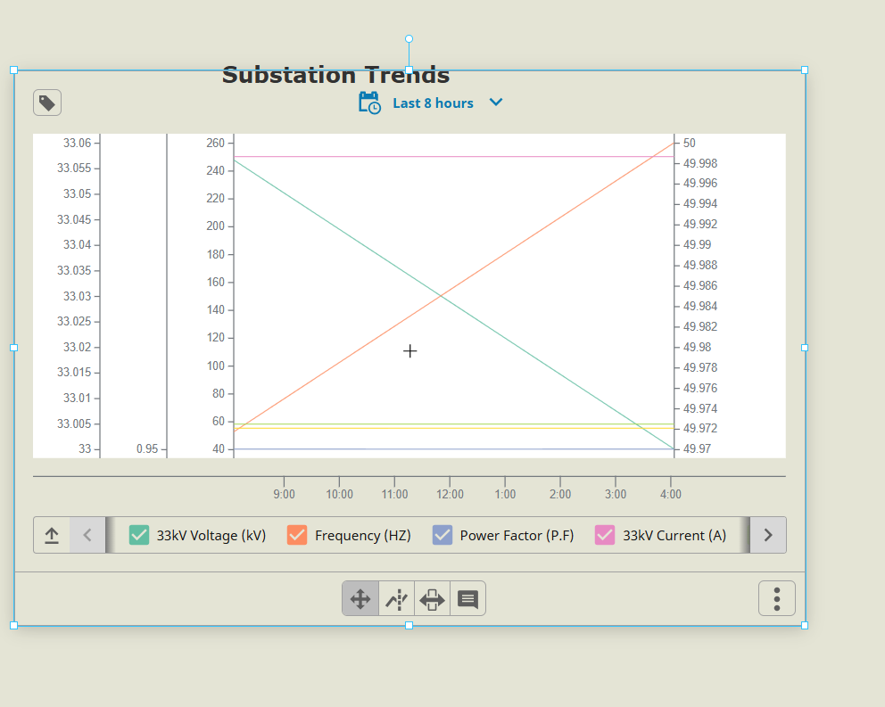
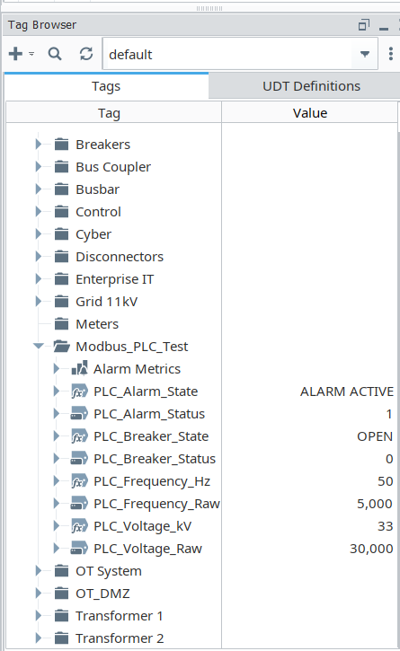
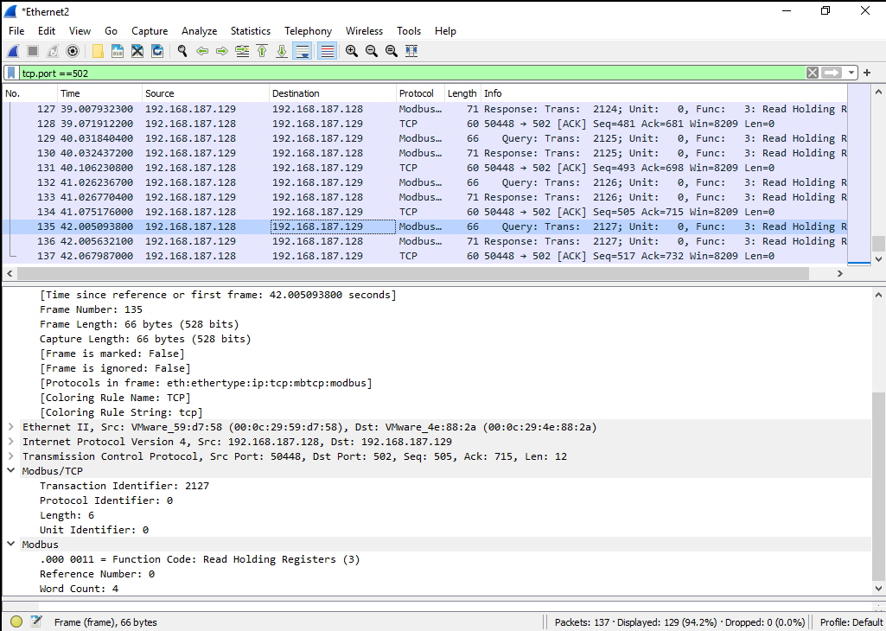
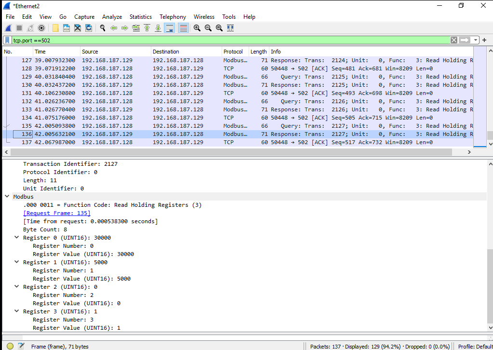
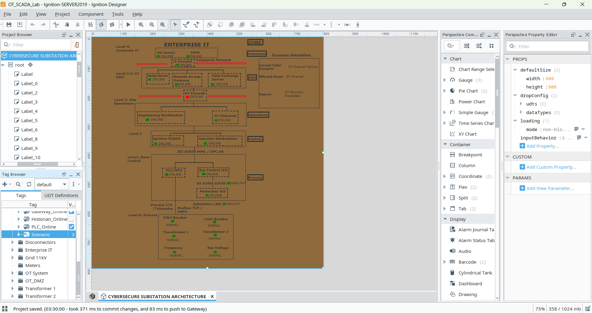

# OT/SCADA Cybersecurity Demonstrator

### Purdue-Based Injection Substation Architecture and Scenario-Driven Monitoring

**Electrical Power Engineering | Project Management | ICS/OT Cybersecurity**

## Project Overview

This project is a simulated OT/SCADA monitoring demonstrator developed using Ignition Designer and Perspective. It combines a Purdue Model-based injection substation architecture with backend tag-driven visualisation, selectable infrastructure-failure scenarios, alarm behaviour, and trend charts.

The project applies my power engineering background to the exploration of industrial control system monitoring, infrastructure availability, and operational awareness.

The demonstrator provides a visual representation of selected enterprise IT and OT components, industrial control devices, and electrical process assets. Backend tag values drive the corresponding status indicators in the Perspective interface.

**Project status:** Working lab demonstrator under development. Six selectable scenarios have been exercised, and alarm behaviour and trend charts have been tested. Further technical documentation, validation, and cybersecurity analysis remain ongoing.

## Project Objectives

- Apply a Purdue Model-based architecture to an electrical injection substation use case.
- Represent enterprise IT, the OT DMZ, site operations, supervisory control, basic control, and the electrical process.
- Use Ignition tags and configured bindings to drive visual asset-status indicators.
- Demonstrate six selectable operating and infrastructure-failure scenarios.
- Test alarm behaviour and trend-chart functionality in the lab.
- Explore how simulated infrastructure states can improve operator visibility and support investigation.
- Establish a foundation for further practical ICS/OT cybersecurity development.

## Architecture Overview

**Figure 1 — Purdue-Based Injection Substation Architecture: Substation LAN Failure Scenario**

This screenshot shows the Ignition Perspective monitoring interface with the Substation LAN Failure scenario selected. Backend tag values drive the displayed status indicators, showing how the OT architecture represents a simulated infrastructure failure. The screenshot documents the selected scenario state; it does not, by itself, demonstrate a real network outage or independently validated cybersecurity controls.

The architecture represents the following Purdue levels and example components.

| Purdue level                  | Representative components                                                 |
| ----------------------------- | ------------------------------------------------------------------------- |
| Level 4 — Enterprise IT       | Active Directory server, SIEM, enterprise network and enterprise firewall |
| Level 3.5 — OT DMZ            | Jump server, remote access gateway, data exchange server and OT firewall  |
| Level 3 — Site Operations     | Engineering workstation and OT historian                                  |
| Level 2 — Supervisory Control | Ignition SCADA/HMI and operator workstation                               |
| Level 1 — Basic Control       | PLC/RTU, bay control IED and protection IED                               |
| Level 0 — Process             | 33 kV and 11 kV breakers, transformers, frequency and bus voltage         |

The architecture illustrates the separation of enterprise, operations, control, and process functions. It also identifies representative trust boundaries and communication paths for further OT security analysis.

The diagram conceptually represents the lab architecture. It does not imply that every illustrated component is a separate deployed system or that the depicted network segmentation has been independently validated.

## Demonstrator Screenshots

The following screenshots illustrate the current Ignition Perspective implementation and its monitoring capabilities.

### 1. Substation Overview Dashboard

The overview presents a simulated injection substation, including electrical measurements, breaker states, transformer information, system status, and selected scenario indicators.

### 2. Alarm Overview Dashboard

The alarm dashboard presents configured alarm sources, their displayed status, and severity. Alarm behaviour has been tested within the lab environment.

### 3. OT Cybersecurity Dashboard

The cyber dashboard provides a visual representation of selected asset status and health indicators, including the PLC, Gateway, historian, and firewall.

### 4. Substation Trend Dashboard

The trend dashboard displays selected electrical measurements, including 33 kV voltage, frequency, power factor, and current over a selected time range. Trend-chart functionality has been tested in the lab.

**Evidence scope:** These screenshots document the current visual implementation. The demonstrator uses backend tag-driven scenario states. Industrial protocol integrations, packet-level attack analysis, and associated detection controls will be documented separately when implemented and tested.

## Technology Stack

- **SCADA/HMI:** Ignition Designer and Perspective.
- **Backend state:** Ignition tags.
- **Visualisation:** Perspective components and configured tag bindings.
- **Monitoring:** Asset-status indicators, alarm behaviour and trend charts.
- **Test environment:** Simulated injection substation and infrastructure states.

## Scenario-Based Monitoring

The demonstrator implements six selectable scenarios identified by numeric values from 0 to 5. Each scenario has been selected and observed changing the backend-driven display.

| ID | Scenario                    | Demonstration objective                                                              |
| -: | --------------------------- | ------------------------------------------------------------------------------------ |
|  0 | Normal Operation            | Display the baseline state of the simulated environment.                             |
|  1 | Substation LAN Failure      | Represent a substation network failure through the relevant visual status indicator. |
|  2 | Historian Failure           | Represent an OT historian failure in the selected scenario.                          |
|  3 | OT Firewall Failure         | Represent an OT firewall failure.                                                    |
|  4 | Enterprise Firewall Failure | Represent an enterprise firewall failure.                                            |
|  5 | IED Failure                 | Represents a failure affecting an intelligent electronic device.                      |

### Testing and Validation

The OT/SCADA demonstrator was evaluated using six predefined scenarios covering normal operation, substation LAN failure, historian failure, OT firewall failure, enterprise firewall failure, and IED failure.

- [Read Scenario Test Results (PDF)](Scenario-Test-Results.pdf)
- [View Scenario Test Results (Markdown)](./Scenario-Test-Results.md)

  ## Scenario-Based Testing and Evidence

The Ignition Perspective demonstrator includes six selectable scenarios representing normal operation and selected OT infrastructure failures. Each scenario has an individual test record documenting the affected asset, displayed impact, observed status indicators, and relevant limitations.

| Scenario | Test Record |
|---|---|
| 0 — Normal Operation | [View test record](Screenshot/Scenario-tests/Scenario-0-Normal-Operation.md) |
| 1 — Substation LAN Failure | [View test record](Screenshot/Scenario-tests/Scenario-1-Substation-LAN-Failure.md) |
| 2 — Historian Failure | [View test record](Screenshot/Scenario-tests/Scenario-2-Historian-Failure.md) |
| 3 — OT Firewall Failure | [View test record](Screenshot/Scenario-tests/Scenario-3-OT-Firewall-Failure.md) |
| 4 — Enterprise Firewall Failure | [View test record](Screenshot/Scenario-tests/Scenario-4-Enterprise-Firewall-Failure.md) |
| 5 — IED Failure | [View test record](Screenshot/Scenario-tests/Scenario-5-IED-Failure.md) |

For the consolidated findings and limitations, see the [Scenario Test Results (PDF)](Scenario-Test-Results.pdf) or [Scenario Test Results (Markdown)](Scenario-Test-Results.md).

## Simulated PLC Integration and Modbus TCP Traffic Analysis

### Overview

The Purdue-based injection substation demonstrator has been extended with a simulated PLC and live process-data integration. A Python-based Modbus TCP server runs on a Parrot Security VM, while Ignition 8.3.9 runs on a Windows Server 2019 VM.

The lab now demonstrates simulated process-data acquisition, breaker-state monitoring, alarm indication, and visibility into Modbus TCP communication using Wireshark.

### Lab Architecture

- **Simulated PLC:** Python-based Modbus TCP server on Parrot Security VM.
- **SCADA/HMI:** Ignition 8.3.9 with Perspective.
- **Gateway:** Windows Server 2019 VM.
- **Protocol:** Modbus TCP.
- **Network:** VMware host-only network, `192.168.187.0/24`.
- **Traffic analysis:** Wireshark on a separate Windows VM, with supplementary packet inspection using `tcpdump` on Parrot.

### Implemented Features

#### 1. Live Process-Data Integration

Ignition reads holding register values from the simulated PLC and updates the Tag Browser automatically.

Implemented tags include:

- `PLC_Voltage_Raw`
- `PLC_Voltage_kV`
- `PLC_Frequency_Raw`
- `PLC_Frequency_Hz`
- `PLC_Breaker_Status`
- `PLC_Breaker_State`
- `PLC_Alarm_Status`
- `PLC_Alarm_State`

The voltage value is scaled into engineering units for display. The Perspective HMI displays the simulated 33 kV supply and breaker state.

#### 2. Two-Source Substation HMI

The Perspective overview represents two incoming 33 kV sources, their respective circuit breakers, the 33 kV busbar, transformers, 11 kV distribution, bus coupler, and loads.

The simulated PLC feedback is associated with the designated 33 kV breaker. Breaker position is displayed separately from supply availability.

#### 3. PLC Alarm Indication

The simulated PLC alarm status is displayed independently from the existing scenario-driven alarm indicators.

- `0` — Normal
- `1` — Alarm active

A dynamic colour indicator distinguishes normal and active PLC alarm states. The existing scenario-driven central alarm count has been extended to include the PLC alarm contribution.

This PLC alarm is a simulated status bit and is not, by itself, a native Ignition alarm event.

#### 4. Modbus TCP Traffic Analysis

Wireshark captures were obtained on the host-only network between:

- Ignition Gateway: `192.168.187.128`
- Simulated PLC: `192.168.187.129`

The captured traffic demonstrates Modbus TCP polling and responses. Wireshark decodes Function Code 3 (Read Holding Registers), including register addresses and returned values.

Supplementary `tcpdump` captures on Parrot provide hexadecimal packet data for further protocol inspection.

**Modbus TCP Read Request**

**Modbus TCP Read Response**

#### 5. Write-Operation Investigation — In Progress

The Python control script uses a Modbus register-write operation to change the simulated breaker and alarm states. The resulting state changes have been observed in Ignition.

However, a write request has not yet been independently identified and verified in the Wireshark capture. The current captures primarily demonstrate Ignition polling and register responses.

The next stage is to isolate and verify the write request, then implement and test a dedicated SCADA-originated command path from Ignition to the simulated PLC.

### Validation Status

| Test | Status |
|---|---|
| Modbus TCP connectivity | Verified |
| Live register updates in Ignition | Verified |
| Voltage scaling and HMI display | Verified |
| Simulated breaker state updates | Verified |
| PLC alarm activation and clearing | Verified |
| Dynamic PLC alarm indicator | Verified |
| Wireshark decoding of Function Code 3 | Verified |
| Write request independently identified in capture | In progress |
| Ignition-to-PLC command path | Planned |

### Cybersecurity Relevance

This lab provides hands-on experience with industrial protocol visibility, SCADA integration, process-data monitoring, and the analysis of Modbus TCP communications.

It also lays the groundwork for examining unauthenticated industrial communications, access-control considerations, command visibility, and the distinction between process feedback and control requests.

### Scope and Limitations

This is a simulated laboratory environment. It is not connected to a physical PLC or an operational substation. The current packet captures establish read polling and responses; a verified SCADA-originated write operation and production-grade OT security controls remain future development objectives.

### Backend-Driven Visualisation

Scenario selection changes backend tag values, which configured Perspective bindings consume to update the visual display.

For example, selecting Scenario 1 — Substation LAN Failure displays a red failure indicator for the relevant network element.

This demonstrates scenario-driven state visualisation in the lab. The precise effect of each scenario on other assets, communication paths, and alarms should be assessed individually rather than assumed from the selected scenario alone.

## Alarm and Trend Monitoring

Alarm behaviour and trend-chart functionality have been tested in the lab environment.

These features support exploration of how changes in simulated operating conditions can be presented to an operator through alarms and time-series visualisation.

Further development will document the configured alarm conditions, tag dependencies, trend data sources, test procedures, and observed results in greater detail.

## Industrial Communication Technologies

The architecture identifies the following industrial communication technologies as relevant design concepts:

- IEC 61850 MMS and GOOSE.
- OPC UA.
- Modbus/TCP.
- DNP3.

These technologies are represented as architecture labels or design concepts. Their inclusion does not imply that the demonstrator has generated, captured, analysed, or integrated protocol traffic.

We will document practical protocol experiments and associated evidence separately as we complete them.

## ICS/OT Cybersecurity Learning Outcomes

This project provides a practical foundation for exploring:

- Purdue Model-based OT architecture.
- Industrial asset visibility and status representation.
- Backend tag-driven monitoring.
- Scenario-based fault visualisation.
- Alarm behaviour and trend monitoring.
- Infrastructure availability and operational dependencies.
- OT network segmentation and trust boundaries as architectural concepts.
- The distinction between monitoring simulated states and detecting real cyber threats.

The current demonstrator focuses on visual monitoring of simulated infrastructure conditions. It is not, by itself, a network intrusion detection system and does not establish the effectiveness of cybersecurity controls.

## Current Status and Future Development

### Implemented and Tested

- Purdue-based injection substation architecture layout.
- Ignition Perspective monitoring interface.
- Backend tag-driven visual status indicators.
- Six selectable scenarios, with observed changes to the backend-driven display.
- Alarm behaviour testing.
- Trend-chart testing.

### Planned Development

- Document individual scenario test procedures and observed results.
- Verify and document the effect of each scenario on relevant assets and alarms.
- Capture screenshots of the working dashboard and scenario states.
- Develop practical IEC 61850 GOOSE traffic analysis.
- Explore industrial protocol analysis and OT network visibility in an isolated lab.
- Document defensive recommendations for segmentation, controlled access, monitoring, and incident response.
- Expand the demonstrator as further features are implemented and validated.

### Development Environment — Ignition Designer

*Figure 6 — Ignition Designer workspace showing the development environment for the Purdue-based injection substation OT/SCADA monitoring demonstrator. The workspace provides context for the Perspective dashboard, project structure, component configuration, and tag-driven development.*

## Professional Background

I am an electrical power engineering and project management professional with more than 15 years of experience in the power sector. I am developing practical ICS/OT cybersecurity capabilities, with a particular interest in industrial control systems, SCADA, industrial communications, and the protection of critical electrical infrastructure.

My goal is to combine power-sector operational knowledge with cybersecurity skills to contribute to the security, resilience, and safe operation of industrial environments.

## Disclaimer

This project is intended for education, technical demonstration, and professional development. All scenarios are simulated in a lab environment and do not represent faults or cyber incidents on a live electrical network.

The presence of a component, architecture label, alarm, or status indicator does not establish that the associated production system or cybersecurity control has been deployed or independently validated.
